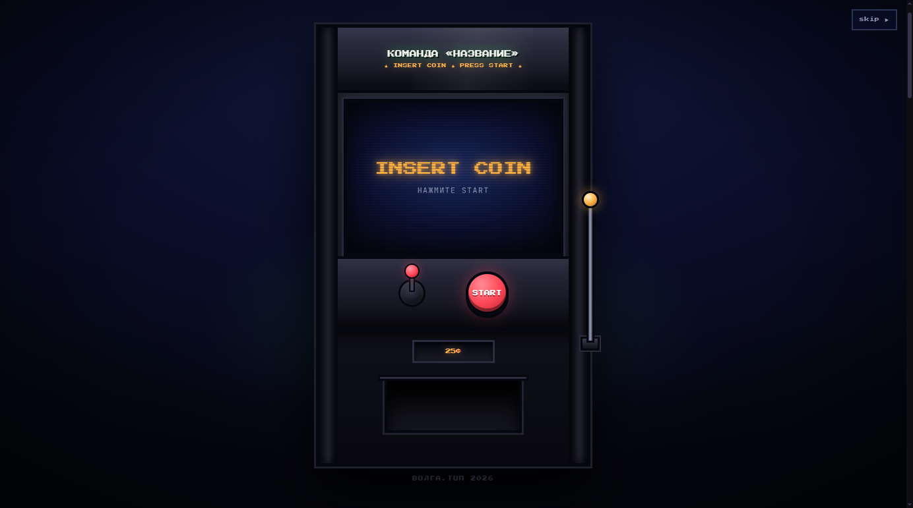
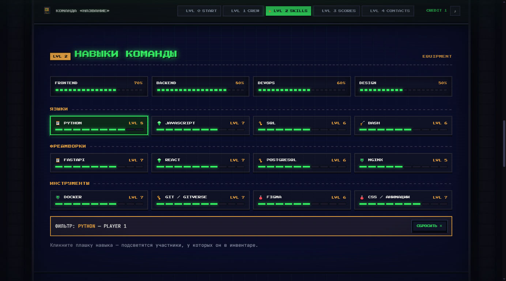
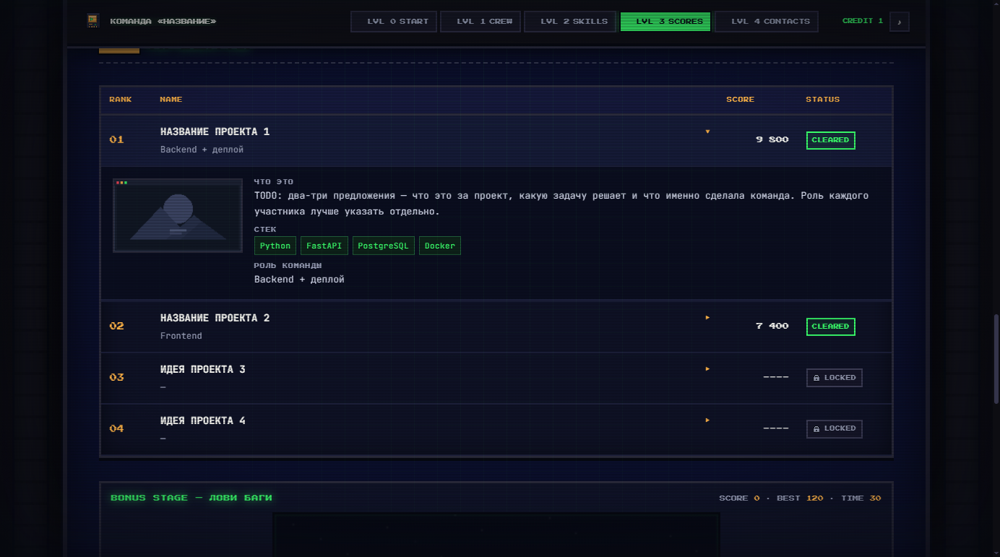
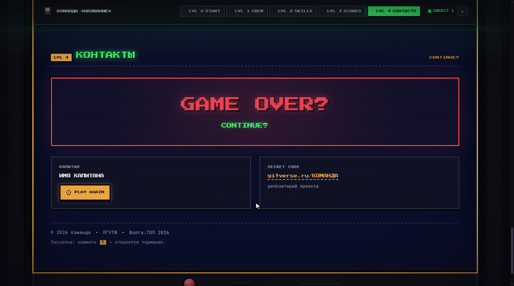
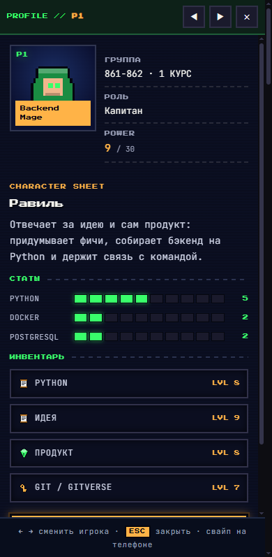
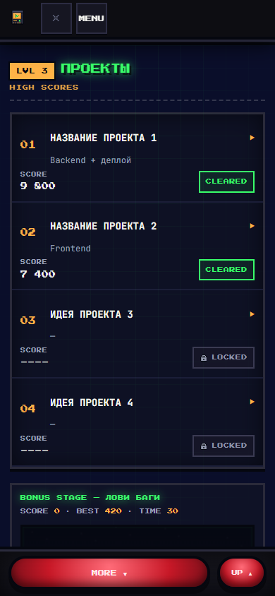

# Сайт команды «НАЗВАНИЕ» — аркадный автомат

Визитка команды для хакатона **«Волга.ТОП 2026»**, собранная как экран старого игрового
автомата: при каждом открытии сайта автомат сам принимает монету и запускает заставку, дальше
пять уровней — команда → участники → навыки → проекты → контакты.

- Статика без сборки: HTML + CSS + JS, контент в JSON.
- Ноль внешних зависимостей: шрифты, спрайты и иконки лежат в репозитории, CDN не нужен.
- Запускается одной командой в Docker.



---

## 1. Команда

> **ЗАПОЛНИТЕ ТАБЛИЦУ.** Данные участников также лежат в `data/crew.json` —
> именно этот файл рендерит карточки на сайте.

| Роль | Имя, фамилия | Группа | Что делал на проекте |
|------|--------------|--------|----------------------|
| Капитан / backend | TODO | TODO | архитектура API, деплой, README |
| Frontend | TODO | TODO | вёрстка, анимации, адаптив |
| DevOps | TODO | TODO | Docker, HTTPS, хостинг |
| Дизайн | TODO | TODO | спрайты, логотип, презентация |

Контакт капитана указывается в `data/site.json` → `contacts`.

---

## 2. Стек

| Слой | Что используется |
|------|------------------|
| Разметка | HTML5, семантические секции, ARIA |
| Стили | CSS3: Grid, Flexbox, `clamp()`, CSS-переменные, `@keyframes`, `steps()` |
| Логика | Vanilla JavaScript (ES6), без фреймворков и сборщика |
| Данные | JSON: `site.json`, `crew.json`, `skills.json`, `scores.json` |
| Шрифты | Press Start 2P (заголовки), JetBrains Mono (текст) — локальные `.woff2` |
| Графика | пиксель-арт PNG, сгенерированный скриптом (спрайты, эмблема, фон уровня, иконки) |
| Сервер | nginx 1.27 alpine в Docker |
| Вспомогательное | Python + Pillow — только для генерации ассетов, в рантайме не нужен |

---

## 3. Архитектура и структура проекта

```
team-site/
├── index.html            # каркас: корпус автомата, шапка, 5 секций, заставка, терминал
├── css/
│   ├── main.css          # сетка, компоненты, адаптив (телефон / 768 / 1440)
│   └── crt.css           # «трубка»: сканлайны, свечение, виньетка, автомат с ручкой, терминал
├── js/
│   ├── data.js           # загрузка JSON + рендер всех секций, печатная машинка, фильтр
│   ├── nav.js            # заставка, меню уровней, клавиатура, звук, пасхалка-терминал
│   └── profile.js        # профиль игрока: окно поверх страницы, ← →, Esc, свайп
├── data/
│   ├── site.json         # название команды, девиз, текст «о команде», контакты
│   ├── crew.json         # участники: класс, группа, статы, инвентарь, спрайт
│   ├── skills.json       # направления, слоты навыков, владельцы навыков
│   └── scores.json       # проекты: статус, стек, роль, описание, скриншот
├── assets/
│   ├── fonts/            # Press Start 2P + JetBrains Mono (woff2, кириллица)
│   ├── sprites/          # портреты участников, иконки инвентаря (16×16 / 24×24)
│   └── img/              # эмблема, фон уровня, favicon, заглушка скриншота
├── docs/screenshots/     # скриншоты для README
├── Dockerfile
├── compose.yml
├── .dockerignore
└── README.md
```

**Поток данных.** `index.html` — только скелет с контейнерами. `js/data.js` читает четыре
JSON-файла, рендерит карточки участников, шкалы навыков, таблицу рекордов и подставляет
тексты. Никакой контент в разметку не «вшит» — правки делаются в JSON.

**Слои стилей.** `main.css` отвечает за композицию и компоненты, `crt.css` — только за
эффекты: сканлайны, бегущая полоса развёртки, виньетку, свечение, стартовый автомат
с ручкой и выплатой монет.
Если убрать `crt.css`, сайт останется читаемым, но потеряет «ретро».

---

## 4. Запуск

### 4.1. Локально, без Docker

Нужен любой статический сервер (из-за `fetch` JSON нельзя открывать файлом).

```bash
# из папки team-site
python -m http.server 8080
# открыть http://localhost:8080
```

Альтернативы: `npx serve .`, `php -S localhost:8080`, расширение Live Server.

### 4.2. Docker

```bash
docker build -t volgatop2026-team-site .
docker run --rm -p 8080:80 volgatop2026-team-site
# открыть http://localhost:8080
```

### 4.3. Docker Compose (рекомендуется)

```bash
docker compose up -d --build
docker compose logs -f
# открыть http://localhost:8080
# остановить: docker compose down
```

Порт меняется одной строкой в `compose.yml` (`"8080:80"`).

### 4.4. Если открыть `index.html` двойным щелчком

Браузер блокирует `fetch` к локальным JSON, поэтому сайт покажет встроенную демо-копию
данных и жёлтую плашку «ДЕМО-РЕЖИМ» с подсказкой запустить сервер. Всё оформление при этом
работает — это удобно для быстрой проверки дизайна, но для настоящего контента нужен сервер.

---

## 5. Как менять контент

Все данные — в `data/`. После правки достаточно обновить страницу.

### `data/site.json` — команда и тексты

| Поле | Что это |
|------|---------|
| `team.title` | название команды, как оно печатается везде («КОМАНДА „НАЗВАНИЕ“») |
| `team.shortName` | короткое название |
| `team.motto` | девиз на заставке |
| `team.university` | вуз (в шапке табло и подвале) |
| `site.event` | название хакатона |
| `site.about` | массив строк — текст «О команде», печатается по одной |
| `site.crewLead` | подзаголовок под «ВЫБЕРИТЕ ИГРОКА» |
| `site.levelCaption` | подпись под пиксельным пейзажем на уровне 0 (`STAGE 0 — RIVER VALLEY`) |
| `site.copyright` | строка в подвале |
| `contacts.captain` | имя капитана |
| `contacts.email` | почта капитана (кнопка PLAY AGAIN) |
| `contacts.telegram` | ссылка на Telegram (пустая строка — ссылка скрыта) |
| `contacts.repo` / `repoLabel` | ссылка на GitVerse и её подпись в блоке SECRET CODE |

`team.shortName` и `team.group` в JSON есть, но на странице не выводятся — оставлены на случай,
если понадобится короткое имя для шапки. Менять их не обязательно.

### `data/crew.json` — участники (массив)

```json
{
  "id": "player1",
  "name": "PLAYER 1",
  "class": "Idea",
  "group": "ГРУППА · КУРС",
  "role": "Капитан",
  "stats": { "Python": 8, "Docker": 6, "PostgreSQL": 5 },
  "inventory": ["python", "postgresql", "docker", "git"],
  "sprite": "assets/sprites/mage.png",
  "contact": "https://t.me/",
  "bio": "TODO: два предложения о человеке."
}
```

- `stats` — 3–4 навыка, значение 0–10 (десять квадратиков).
- `inventory` — id навыков из `skills.json`; иконка и `LVL` берутся оттуда. Незнакомый id
  не ломает профиль: он покажется словом-заглушкой без уровня.
- `sprite` — картинка 24×24 (или любая квадратная, масштабируется без сглаживания).
- `class` уходит в бейдж на портрете, `role` — в строку под именем.
- `bio` и `contact` видно в профиле игрока: `bio` — абзац, `contact` — кнопка-ссылка.
  Пустой `contact` (или заготовка `https://t.me/` без имени) покажет «Контакт не указан»;
  если поле пустое у капитана, подставляется `contacts.telegram` из `site.json`.

### `data/skills.json` — статы команды

`directions` — агрегированные шкалы направлений (0–10 → 20 сегментов).
`slots` — группы плашек; у каждого навыка `level` 0–10, `icon`, `owners` (id участников).

### `data/scores.json` — проекты (массив)

`status`: `"CLEARED"` (зелёный) или `"LOCKED"` (серый, с замком).
`stack` — чипы технологий, `role` — строка под названием, `shot` — путь к скриншоту,
`link` — внешняя ссылка (если пусто, кнопка не выводится). Пустые `stack` и `role`
в раскрытой строке не выводятся.

> Совет: чтобы «снять замок» с идеи, поменяйте `LOCKED` на `CLEARED`.

### Что остаётся в `index.html` — рамки, а не контент

Всё смысловое (команда, участники, навыки, проекты, контакты) берётся из JSON.
В разметке остались только служебные надписи интерфейса — их правят прямо в `index.html`:

| Надпись | Строки `index.html` |
|---------|---------------------|
| Пункты меню `LVL 0 START` … `LVL 4 CONTACTS` | 54–58 |
| Бегущая строка `INSERT COIN ✦ 5 УРОВНЕЙ ✦ PRESS START …` | 36–37 |
| Заголовки секций `О КОМАНДЕ`, `ВЫБЕРИТЕ ИГРОКА`, `НАВЫКИ КОМАНДЫ`, `ПРОЕКТЫ`, `КОНТАКТЫ` | 74, 111, 124, 144, 171 |
| Подписи под заголовками `START`, `CHARACTER SELECT`, `EQUIPMENT`, `HIGH SCORES`, `CONTINUE?` | 75, 112, 125, 145, 172 |
| Ключи табло `PLAYERS`, `SKILLS`, `SCORES`, `LEVELS` | 96–99 |
| Колонки таблицы `RANK`, `NAME`, `STATUS` | 156–158 |
| Заставка: `INSERT COIN`, `автомат включается…`, `START`, `skip ▶` | 242, 243, 249, 230 |
| Контакты: `КАПИТАН`, `SECRET CODE`, `PLAY AGAIN`, `GAME OVER?`, `CONTINUE?` | 175–204 |
| Терминал: `TERMINAL v1.0 — команды: help, crew, …` | 272 |
| Профиль игрока: окно, `PROFILE //`, `СТАТЫ`, `ИНВЕНТАРЬ`, `POWER`, подсказка в подвале | 283–334 |

### Правила правки JSON

1. Кавычки только двойные, запятая после последнего поля не ставится — иначе браузер
   не прочитает файл и сайт покажет встроенную демо-копию.
2. Сохраняйте файл в UTF-8 (без BOM), иначе вместо «КОМАНДА» на странице появится «ÐšÐžÐœÐÐДÐл».
3. `id` участника (`player1` … `player4`) не меняйте — на него ссылаются `owners` в `skills.json`.
   А вот `name`, `class`, `role`, `bio`, `stats` — это и есть имена героев, их правят свободно.
4. `name` — имя в карточке и в фильтре навыков, `class` — бейдж на портрете, `role` — строка под именем.
5. После правки достаточно обновить страницу: JSON читается с `cache: no-store`, кэш мешать не будет.
6. Если появилась жёлтая плашка «ДЕМО-РЕЖИМ» — в JSON опечатка. Проверьте файл,
   например, открыв его на `jsonlint.com`, или сравните запятые с соседними строками.

> Демо-копия в `js/data.js` (объект `FALLBACK`) нужна только для открытия `index.html`
> двойным щелчком. При работе через сервер она не используется, синхронизировать её не нужно.

---

## 6. Что реализовано

### Секции (п. 4 задания)

| Уровень | Что внутри |
|---------|-----------|
| Шапка | мини-эмблема, название, меню уровней `LVL 0 START … LVL 4 CONTACTS`, активный пункт с курсором ▶ |
| LVL 0 | табло `HI-SCORE`, текст о команде с эффектом печатной машинки, счётчики, пиксельный пейзаж |
| LVL 1 | `CHARACTER SELECT`: карточки с портретом, классом, группой, сегментными статами, инвентарём; клик по карточке открывает профиль игрока |
| LVL 2 | `EQUIPMENT`: агрегированные шкалы направлений и плашки навыков с `LVL N`, фильтр по навыку |
| LVL 3 | `HIGH SCORES`: таблица `RANK / NAME / STATUS`, раскрывающиеся строки |
| LVL 4 | `GAME OVER?` → `CONTINUE? 9…1 → YES`, кнопка-монета PLAY AGAIN, SECRET CODE, подвал |

### Интерактив (п. 4.6)

1. **Выбор уровня** — клик по пункту меню, плавная прокрутка, автоподсветка уровня при
   скролле, стрелки ←→↑↓ на клавиатуре, Enter — к текущему уровню.
2. **Автомат на входе** — стартовый экран собран из CSS без картинок: корпус с лайтбоксом,
   экран с надписью `INSERT COIN` (мигание через `steps()`), панель с джойстиком и кнопкой
   `START`, монетоприёмник, лоток и ручка справа. Заставка играет сама, без кликов: через
   секунду монета падает в монетоприёмник (вспышка слота, звук), рычаг уходит вниз, корпус
   вздрагивает, из лотка сыплются 30 монет с разлётом и вращением, звучит механический щелчок
   и каскад «дзынь» (Web Audio), а экран меняется на `PRESS START`. Клик или Enter открывает
   уровень 0; клик во время анимации перематывает её сразу к `PRESS START`. Ссылка `skip ▶`
   и Escape закрывают заставку в любой момент. Заставка показывается при **каждом** открытии
   страницы: отметки «уже видел» в `localStorage` нет, так что после перезагрузки автомат
   запускается заново. При `prefers-reduced-motion` монеты и рычаг отключены — сразу `PRESS START`.
3. **Фильтр навыков** — клик по плашке подсвечивает карточки участников, владеющих
   навыком, остальные приглушаются; строка фильтра показывает имена.
4. **Профиль игрока** — клик по любой точке карточки (или по кнопке `PROFILE ▶`) открывает
   окно поверх страницы: большой портрет, класс, группа, роль, `POWER` (сумма статов),
   статы крупными шкалами с поочерёдной заливкой, инвентарь с `LVL` и кнопка-контакт.
   Внутри окна: `◀ ▶` или клавиши ← → листают игроков по кругу, `Esc`, `×` или кнопка
   `ЗАКРЫТЬ` возвращают на страницу, свайп влево/вправо работает на телефоне.
   Пока окно открыто, страница под ним не прокручивается, а фокус ходит только по окну
   (Tab по кругу, `inert` на корпусе); после закрытия фокус возвращается на карточку.
5. **HIGH SCORES** — клик по строке раскрывает описание, стек, роль и скриншот.
6. **Пасхалка** — клавиша `T` открывает терминал: `help`, `crew`, `skills`, `scores`,
   `contact`, `clear`, `exit`; есть история команд стрелками.
7. **Звук** — Web Audio без файлов (монета, выбор, клик), кнопка `♪` выключает и помнит выбор.
8. **Бонус** — панель управления: джойстик, красные кнопки `MORE`/`UP`, монетоприёмник.

### Адаптив

| Ширина | Поведение |
|--------|-----------|
| 1440 | корпус с боковинами, экран 1200 px по центру, 4 карточки в ряд |
| 768 | корпус сужается, меню уровней в одну строку со скроллом, 2 карточки в ряд, цели нажатия от 40 px |
| ≤560, телефон | экран на всю ширину, меню сворачивается в кнопку `MENU` (пункты 50 px), карточки в столбик, спрайты 68 px, сканлайны отключены, панель `MORE`/`UP` прилипает к низу экрана |
| ≤560, телефон | таблица HIGH SCORES раскладывается в карточки-строки: горизонтальной прокрутки нет, `RANK`/`NAME` сверху, `STATUS` снизу |
| ≤560, телефон | все цели нажатия не меньше 44×44 px, пиксельный шрифт не мельче 8 px, отступы учитывают `env(safe-area-inset-*)` |
| ≤600 и альбом | автомат на заставке ужимается, подпись под ним скрывается, бегущая строка убирается, кегли держат нижний предел |

### Доступность и SEO

- семантические секции, один `h1`, корректный порядок заголовков, `caption` и `scope` у таблицы;
- у всех кнопок и ссылок есть доступные имена, у декоративной графики `alt=""`;
- контраст текста — от 7:1 (при норме 4.5:1), основной текст не меньше 16 px;
- `:focus-visible` с заметной обводкой, ссылка «Перейти к содержимому», `aria-expanded`,
  `aria-pressed`, `aria-live` у обратного отсчёта и терминала;
- профиль игрока — настоящий модальный диалог: `role="dialog"`, `aria-modal`, заголовок из
  имени игрока, ловушка фокуса по Tab, возврат фокуса на карточку, `inert` на остальной
  странице и `aria-live`-объявление «Профиль 2 из 3: …» при листании;
- заставка не прячет контент от поисковиков и скринридеров: разметка остаётся в DOM,
  оверлей не модальный, без JS он скрыт через `<noscript>`;
- `prefers-reduced-motion` отключает мигание, печатную машинку, ленту и анимации появления.

---

## 7. Скриншоты

| Уровень 0 | Уровень 1 |
|-----------|-----------|
|  |  |

| Уровень 2 | Уровень 3 | Уровень 4 |
|-----------|-----------|-----------|
|  |  |  |

Профиль игрока — окно, которое открывается кликом по карточке:

| Десктоп | Телефон |
|---------|---------|
|  |  |

Мобильная версия (телефон 390×844):

| Заставка | Карточки участников | HIGH SCORES |
|----------|---------------------|-------------|
|  |  |  |

Скриншоты сняты с локального запуска (Chromium, 1384×771 для десктопа и 390×844 для телефона;
окно профиля — 1384×797 и 390×797).
Пересъёмка после правок: откройте сайт и снимите заново те же состояния.

---

## 8. Работа с ИИ

> **ЗАПОЛНИТЕ РАЗДЕЛ** под фактическое использование. Экспорты сессий должны попасть
> в `ai-sessions.zip` до публикации.

| Инструмент | Для чего использовали | Что проверяли руками |
|------------|----------------------|----------------------|
| TODO | TODO | TODO |
| TODO | TODO | TODO |

Правила, которых придерживались:

- ИИ предлагает — команда решает: сгенерированные фрагменты проверены и переписаны под проект;
- пиксель-арт сгенерирован скриптом (`make_assets.py` лежит рядом с папкой сайта) и
  доработан вручную — спрайты легко заменить своими;
- тексты о команде пишут люди, ИИ не придумывает факты об участниках;
- все ИИ-сессии сохранены и приложены к сдаче.

---

## 9. Деплой на хостинг

Сайт — статика, подходит любой российский хостинг с Docker или с nginx:

1. собрать образ и запушить на сервер (`docker save`/`docker load` или git + сборка на сервере);
2. `docker compose up -d` — приложение слушает `8080`, наружу отдать через nginx-proxy;
3. выпустить сертификат (Let's Encrypt / certbot или панель хостинга) и включить
   переадресацию `http://` → `https://`;
4. проверить внешнюю ссылку, `robots.txt`/индексацию, время ответа.

Для проверки «как у жюри» достаточно `docker compose up -d --build` на чистой машине.

---

## 10. Заметки по реализации

- **`data/site.json` добавлен** к трём файлам из ТЗ: тексты о команде и контакты тоже
  должны жить в JSON, а не в разметке (п. 4.5). Если файла нет — используются встроенные
  значения.
- **Подсветка активного уровня** сделана на позиции скролла (через `requestAnimationFrame`),
  а не на `IntersectionObserver`: с липкой шапкой и разной высотой секций так точнее.
  `IntersectionObserver` используется для анимаций появления — шкал, карточек и блоков.
- **Карточки, шкалы и таблица** полностью строятся из JSON: в HTML нет ни одного
  захардкоженного участника или проекта.
- **Шрифты локальные**: Press Start 2P отдаёт кириллицу отдельным файлом, поэтому в
  `@font-face` два `src` с `unicode-range`. Без интернета сайт выглядит так же.
- **Спрайты 24×24** масштабируются в CSS (`image-rendering: pixelated`) — их можно заменить
  на свои того же стиля, ничего не пересчитывая.
- **Профиль игрока — один диалог на всю страницу** (`#prof` в `index.html`). `js/profile.js`
  только наполняет его данными выбранного участника, поэтому добавление игрока или смена
  статов в `crew.json` не требует правок в разметке. Заливка шкал переиспользует те же
  сегменты `.seg`, что и карточки, — анимация запускается после вставки в DOM.
- **Иконка замка** у `LOCKED`-проектов и монета PLAY AGAIN — отдельные PNG в `assets/sprites/`.

---

## 11. Лицензия и авторство

Код — MIT. Пиксель-арт и шрифты: Press Start 2P и JetBrains Mono — SIL Open Font License,
лежат локально в `assets/fonts/`.

© 2026 Команда «НАЗВАНИЕ» · ПГУТИ · Волга.ТОП
