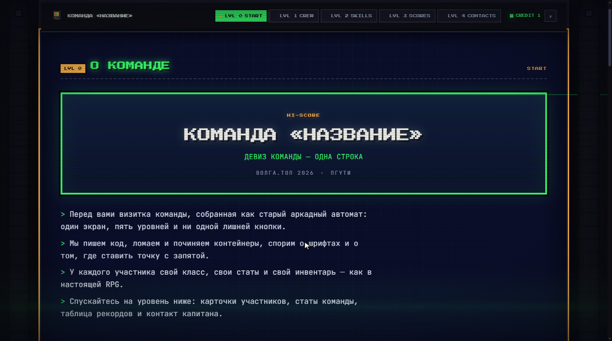
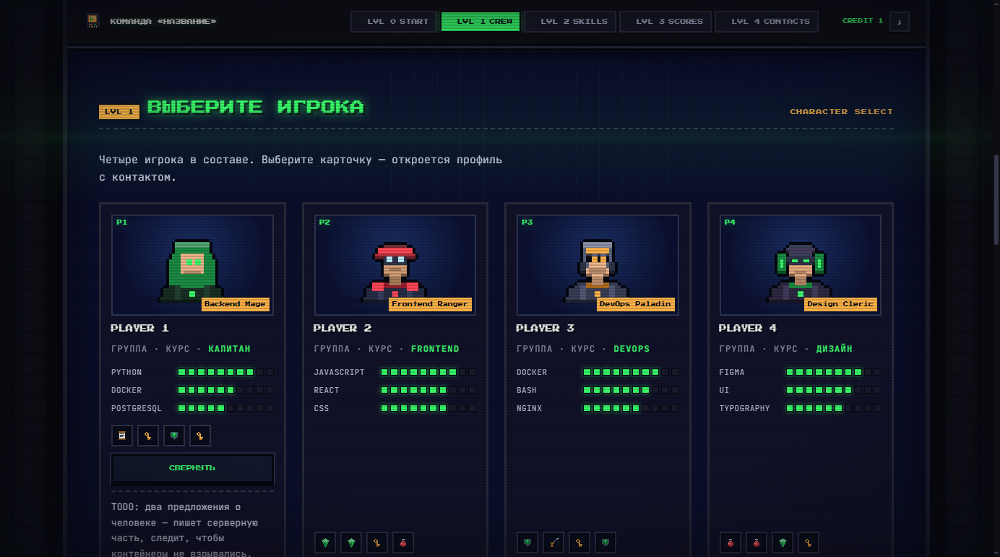
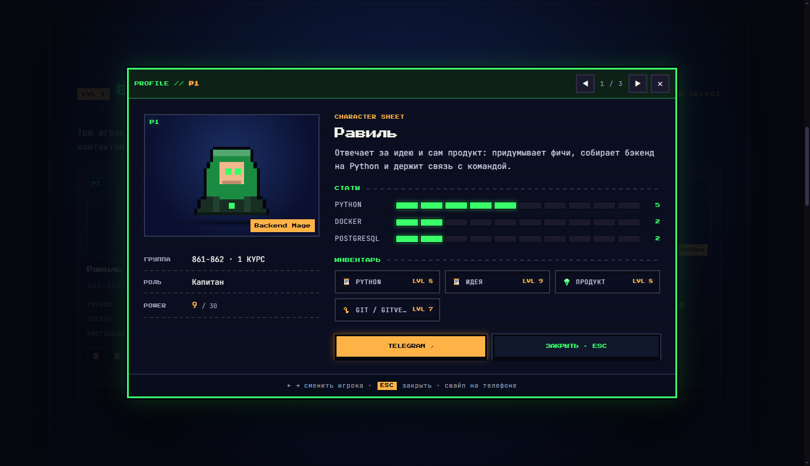
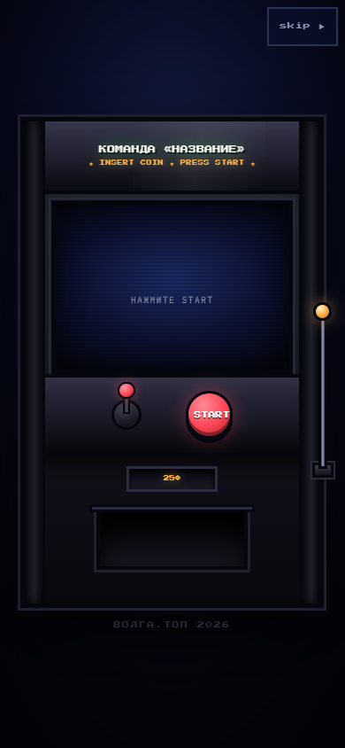
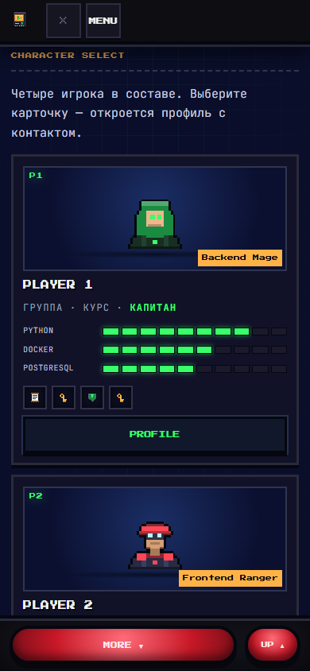

# TATARINNOVATION — сайт-визитка команды («аркадный автомат»)

Визитка команды **TATARINNOVATION** для Всероссийского хакатона «Волга.ТОП 2026», оформленная
как экран ретро-аркадного автомата. При каждом открытии страницы автомат сам принимает монету,
запускает заставку и открывает пять уровней: команда → участники → навыки → проекты → контакты.
Назначение проекта — представить команду, её компетенции и контакты в интерактивной форме.

- **Статика без сборки:** HTML5 + CSS3 + Vanilla JavaScript (ES6), весь контент вынесен в JSON.
- **Без внешних зависимостей:** шрифты, спрайты и иконки лежат в репозитории, CDN не используется —
  сайт одинаково выглядит без интернета.
- **Запуск одним действием:** локальный статический сервер или `docker compose up -d --build`.

Репозиторий проекта: ⟨вписать: публичный репозиторий в GitVerse⟩


---

## 1. Команда

Состав команды совпадает с данными на сайте: карточки участников строятся из `data/crew.json`,
единый контакт капитана задаётся в `data/site.json` → `contacts`.

| ФИО | Учебная группа | Роль | Профиль GitVerse | Личный вклад |
| :--- | :--- | :--- | :--- | :--- |
| Зиганшин Равиль | 861-ТОП862 | Капитан, разработчик | ⟨вписать: профиль GitVerse⟩ | Координация команды, проектирование структуры данных (`data/*.json`), архитектура решения, документация (`README.md`, `DATA-MAP.md`) |
| Галеев Григорий | 861-ТОП862 | Frontend-разработчик | ⟨вписать: профиль GitVerse⟩ | Вёрстка секций (`index.html`, `css/main.css`), модульная логика (`js/data.js`, `js/nav.js`, `js/profile.js`), интерактивные элементы и адаптив |
| Сафин Реаль | 861-ТОП862 | Frontend-разработчик, инфраструктура | ⟨вписать: профиль GitVerse⟩ | Контейнеризация (`Dockerfile`, `compose.yml`), веб-сервер, проверка запуска на чистой машине, схема развёртывания |
| Загриев Амир | 861-ТОП862 | Дизайнер | ⟨вписать: профиль GitVerse⟩ | Визуальная концепция автомата, пиксель-арт спрайты и иконки (`make_assets.py`), CRT-стилизация (`css/crt.css`) |

Все участники — студенты одной образовательной организации, учебная группа 861-ТОП862.

---

## 2. Реализованное решение

Разработан одностраничный сайт: один HTML-файл как каркас, пять смысловых секций, оверлей
стартовой заставки, модальное окно профиля участника и скрытый терминал. Никакой контент
не «вшит» в разметку — участники, навыки, проекты и тексты подставляются из JSON.

### Обязательные разделы сайта (п. 3 задания)

| Раздел по заданию | Что реализовано на сайте |
| :--- | :--- |
| Шапка | Пиксельная эмблема, название команды, девиз, меню уровней `LVL 0 START … LVL 4 CONTACTS` с индикатором активного раздела `▶` и переключателем звука |
| О команде | Секция `START`: табло `HI-SCORE` с брендовым блоком команды, приветственный текст с эффектом печатной машинки — кто мы и почему участвуем в хакатоне (п. 3 задания), счётчики статистики, пиксельный ночной пейзаж |
| Участники | Секция `CHARACTER SELECT`: карточка на каждого из четырёх участников — имя, пиксельный аватар, класс, учебная группа, сегментные шкалы навыков, инвентарь; клик открывает профиль игрока с биографией и контактом |
| Навыки команды | Секция `EQUIPMENT`: агрегированные шкалы направлений разработки и плашки технологий с уровнем `LVL`; клик по плашке фильтрует карточки участников по `crew.json → inventory` |
| Проекты | Секция `HIGH SCORES`: таблица `RANK / NAME / STATUS` (`CLEARED` / `LOCKED`), клик по строке раскрывает описание, стек, роль, скриншот и ссылку |
| Контакты и подвал | Секция `CONTINUE?`: кнопка-монета `PLAY AGAIN` (письмо капитану), блок `SECRET CODE` со ссылкой на репозиторий, обратный отсчёт `GAME OVER?`, подвал страницы |

### Интерактивные возможности (п. 4.6 задания)

1. **Заставка автомата.** При открытии страницы монета падает в монетоприёмник, рычаг уходит вниз,
   из лотка сыплются монеты, звучит механический щелчок — экран переходит в `PRESS START`.
   Клик, `START` или `Enter` открывают уровень 0; `skip ▶` и `Esc` пропускают заставку.
   При `prefers-reduced-motion` анимация монет отключена — сразу `PRESS START`.
2. **Навигация по уровням.** Клик по меню с плавной прокруткой и автоподсветкой активного раздела
   при скролле, клавиши `←` `→` `↑` `↓`, `Enter` — переход к текущему уровню.
3. **Фильтр навыков.** Клик по плашке навыка подсвечивает карточки участников, у которых навык
   указан в `inventory`, остальные приглушаются; строка фильтра показывает имена.
4. **Профиль игрока.** Модальное окно с биографией, показателем `POWER`, шкалами навыков,
   инвентарём и контактом; листание `◀` `▶`, клавишами `←` `→` и свайпом, закрытие по `Esc` или `×`.
5. **Раскрытие проектов.** Клик по строке `HIGH SCORES` разворачивает подробности проекта.
6. **Терминал (пасхалка).** Клавиша `T` открывает консоль с командами `help`, `crew`, `skills`,
   `scores`, `contact`, `clear`, `exit` и историей ввода по стрелкам.
7. **Звук.** Синтез через Web Audio API без внешних файлов, кнопка `♪` включает и отключает звук
   и запоминает выбор.

### Адаптивность (п. 4.4 задания)

Вёрстка проверяется на ширинах 360, 768 и 1440 px. Сетка перестраивается по контрольным точкам:
`≥1200` — полный корпус с четырьмя карточками в ряд; `≤1100`, `≤900`, `≤760` — промежуточные
состояния (две карточки в ряд, сжатие корпуса); `≤560` — телефон: меню сворачивается в кнопку
`MENU`, карточки идут в столбик, таблица рекордов раскладывается в карточки-строки без
горизонтальной прокрутки, цели нажатия не меньше 44×44 px; `≤400` — узкие экраны.
Отдельные правила для альбомной ориентации с низкой высотой экрана.

### Доступность

Семантические секции, один `h1`, корректный порядок заголовков, `caption` и `scope` у таблицы.
У кнопок и ссылок есть доступные имена, у декоративной графики `alt=""`. Контраст основного
текста не ниже 7:1, размер не меньше 16 px, есть `:focus-visible`, ссылка «Перейти к содержимому»,
`aria-expanded`, `aria-pressed`, `aria-live` у обратного отсчёта и терминала. Профиль участника —
настоящий модальный диалог: `role="dialog"`, `aria-modal`, ловушка фокуса по `Tab`, `inert` на
фоновой разметке и возврат фокуса на карточку после закрытия.

---

## 3. Технологический стек

| Категория | Технологии и версии |
| :--- | :--- |
| Разметка | HTML5 (семантические теги, ARIA-атрибуты) |
| Стилизация | CSS3: CSS Grid, Flexbox, `clamp()`, Custom Properties, `@keyframes`, `steps()`, `image-rendering: pixelated` |
| Клиентская логика | Vanilla JavaScript (ES6+): Fetch API, IntersectionObserver, Web Audio API — без фреймворков, сборщиков и транспиляции |
| Хранение данных | JSON: `data/site.json`, `data/crew.json`, `data/skills.json`, `data/scores.json` |
| Типографика | Press Start 2P, JetBrains Mono — локальные `.woff2` с раздельными файлами для кириллицы и латиницы, лицензия SIL OFL |
| Веб-сервер (контейнер) | nginx 1.27-alpine |
| Контейнеризация | Docker, Docker Compose v2 |
| Генерация графики (вспомогательно) | Python 3.8+ и Pillow — только для `make_assets.py` и `инфографика/make_logo.py`, в рантайме сайта не требуются |

Внешней базы данных и пакетных менеджеров в рантайме нет: все ресурсы находятся в репозитории,
`fetch` запрашивает JSON по относительным путям.

Файлов управления зависимостями (`package.json`, `requirements.txt`) в проекте нет намеренно:
в рантайме нечего устанавливать, а сборка задаётся `Dockerfile` и `compose.yml` — этого
достаточно для п. 5.2. Единственная внешняя зависимость — Pillow для вспомогательных скриптов
`make_assets.py` и `инфографика/make_logo.py`; в образ она не попадает и для запуска сайта
не требуется.

---

## 4. Архитектура

### Компоненты

| Компонент | Назначение |
| :--- | :--- |
| `index.html` | Единая точка входа и семантический каркас: корпус автомата, липкая шапка, пять секций, оверлей заставки, модальный диалог профиля, терминал |
| `css/main.css` | Дизайн-система: локальные `@font-face`, палитра на CSS-переменных, сетки карточек, сегментные шкалы, таблица проектов, адаптив |
| `css/crt.css` | Только эффекты ЭЛТ-экрана: сканлайны, полоса развёртки, виньетка, мерцание, анимация автомата с монетами, стили терминала |
| `js/data.js` | Загрузка `data/*.json` с `cache: 'no-store'`, подстановка текстов через `[data-site-text]`, рендер секций, печатная машинка, фильтр навыков, резервный набор `FALLBACK` для открытия по `file://` |
| `js/nav.js` | Стартовая заставка, скролл-навигация через `requestAnimationFrame`, клавиатурное управление, синтезатор звуков Web Audio, терминал |
| `js/profile.js` | Контроллер модального окна профиля: наполнение данными, ловушка фокуса, `inert`, свайпы |
| `data/*.json` | Единый источник контента; правка сайта не требует изменения разметки |
| `assets/` | Шрифты `.woff2`, спрайты 24×24 и иконки 16×16, эмблема, фон уровня, favicon |
| `инфографика/` | Генератор логотипа `make_logo.py` и готовые SVG/PNG (лок-апы и знаки для светлого и тёмного фона) |
| `Dockerfile`, `compose.yml` | Сборка статики в nginx-контейнер и запуск одной командой |
| `make_assets.py` | Генерация пиксель-арта (спрайты, иконки, фон) на Python + Pillow |
| `DATA-MAP.md` | Карта данных: какой ключ JSON куда выводится, правила правки, чек-лист перед сдачей |

### Поток данных

```
data/*.json  ──fetch (cache: no-store)──►  Arcade.data.{site, crew, skills, scores}
                                               │
                                               ├─► applyTexts()    тексты в [data-site-text] и контакты
                                               ├─► renderAbout()   site.about[] + счётчики табло
                                               ├─► renderCrew()    карточки участников в #crewGrid
                                               ├─► renderSkills()  #directions + #skillSlots
                                               └─► renderScores()  строки в #scoresBody
                                                        │
                                                        └─► событие arcade:ready ──► js/nav.js, js/profile.js
```

`index.html` содержит только контейнеры и служебные надписи интерфейса. Если JSON не загрузился
(открытие файлом, синтаксическая ошибка), `js/data.js` подставляет встроенный набор `FALLBACK`
и показывает жёлтую плашку «ДЕМО-РЕЖИМ» — сайт остаётся работоспособным для проверки дизайна.

### Принятые решения

- **Подсветка активного уровня — по позиции скролла**, а не через `IntersectionObserver`:
  с липкой шапкой и разной высотой секций так точнее. `IntersectionObserver` используется
  для анимаций появления карточек и шкал.
- **Один диалог профиля на всю страницу.** `js/profile.js` только наполняет его данными,
  поэтому добавление участника или смена статов в `crew.json` не требует правок в разметке.
- **Контент полностью в JSON** (п. 4.5 задания): ни одного захардкоженного участника или проекта.
- **Локальные шрифты с `unicode-range`:** Press Start 2P отдаёт кириллицу отдельным файлом,
  поэтому в `@font-face` два `src`.
- **Спрайты 24×24 масштабируются в CSS** с `image-rendering: pixelated` — их можно заменить
  на свои того же стиля без пересчёта.

---

## 5. Установка и запуск

### 5.1. Требования к окружению

- Python 3.8+ — либо любой другой статический HTTP-сервер (`Node.js` + `serve`, `PHP`,
  расширение Live Server); для контейнерного запуска Python не нужен;
- любой современный браузер: Chrome, Firefox, Edge, Яндекс Браузер, Safari;
- для контейнерного запуска — Docker с плагином Compose v2.

Запросы `fetch` к локальным JSON по протоколу `file://` блокируются политикой браузера,
поэтому сайт запускается через HTTP-сервер.

### 5.2. Локальный запуск без Docker

Из корневой папки проекта:

```sh
python -m http.server 8080
```

Альтернативы:

```sh
npx serve .
php -S localhost:8080
```

### 5.3. Запуск в Docker

```sh
docker build -t volgatop2026-team-site .
docker run --rm -p 8080:80 volgatop2026-team-site
```

### 5.4. Запуск через Docker Compose (рекомендуется)

```sh
docker compose up -d --build
docker compose logs -f
docker compose down
```

Порт публикуется строкой `"8080:80"` в `compose.yml`, контейнер перезапускается
при падении (`restart: unless-stopped`), здоровье проверяется через `healthcheck`.

### 5.5. Открытие без сервера

Если открыть `index.html` двойным щелчком, сайт запустится в ознакомительном режиме:
подставится резервный набор данных из `js/data.js` и появится жёлтая плашка «ДЕМО-РЕЖИМ».
Оформление и интерактив при этом работают, но для настоящего контента нужен сервер.

### 5.6. Адрес после запуска

Сайт открывается в браузере по адресу:

- `http://localhost:8080`
- `http://127.0.0.1:8080`

---

## 6. Структура репозитория

```
.
├── index.html                # каркас: корпус автомата, 5 уровней, заставка, профиль, терминал
├── css/
│   ├── main.css              # дизайн-система, сетки, компоненты, адаптив
│   └── crt.css               # CRT-эффекты, анимация автомата и монет, терминал
├── js/
│   ├── data.js               # загрузка JSON, рендер секций, печатная машинка, фильтр навыков
│   ├── nav.js                # заставка, навигация по уровням, звук Web Audio, терминал
│   └── profile.js            # модальный профиль участника: фокус, листание, свайпы
├── data/
│   ├── site.json             # название команды, девиз, текст «О команде», контакты
│   ├── crew.json             # четыре профиля: класс, группа, статы, инвентарь, контакт
│   ├── skills.json           # направления разработки и плашки навыков с уровнями
│   └── scores.json           # проекты: статус, стек, роль, описание, скриншот
├── assets/
│   ├── fonts/                # Press Start 2P и JetBrains Mono (.woff2, кириллица + латиница)
│   ├── sprites/              # пиксельные портреты 24×24 и иконки инвентаря 16×16
│   └── img/                  # эмблема, фон уровня, favicon, заглушка скриншота
├── инфографика/
│   ├── make_logo.py          # генератор логотипа (лок-апы и знаки, светлая и тёмная версии)
│   ├── logo-serious.html     # страница предпросмотра вариантов логотипа
│   └── логотип/              # готовые SVG и PNG: lockup-v, lockup-h, mark-a, favicon
├── docs/screenshots/         # скриншоты десктопной и мобильной версий для README
├── make_assets.py            # генерация пиксель-арта на Python + Pillow
├── DATA-MAP.md               # карта данных: ключи JSON, правила правки, чек-лист
├── Dockerfile                # сборка статики в образ nginx
├── compose.yml               # запуск одной командой: порт, restart, healthcheck
├── .dockerignore             # что не попадает в образ
├── .gitignore                # служебные файлы вне репозитория
└── README.md                 # документация проекта
```

Каталоги названы по назначению, файлы — по содержимому; в `js/` модули разделены по
ответственности (данные, навигация и эффекты, модальный профиль).

---

## 7. Использование искусственного интеллекта

Инструменты искусственного интеллекта применялись на всех направлениях работы команды, включая
дизайн. Каждая существенная сессия сохранена, привязана к конкретной задаче и лежит в архиве
`ai-sessions.zip` в корне репозитория. Сессии выполнялись в едином рабочем пространстве команды;
в колонке «Участник» указан ответственный за направление — он ставил задачу, проверял и принимал
результат, поэтому может объяснить относящиеся к его вкладу решения на собеседовании.

### 7.1. ИИ в дизайне и вёрстке сайта

Дизайн — направление, где ИИ применялся плотнее всего, поэтому его стоит показать отдельно.

- **Знак и логотип.** Сгенерирован знак «A» и два лок-апа — вертикальный и горизонтальный.
  Знак выпущен в трёх цветовых вариантах (синий, зелёный, монохром) и в наборах размеров
  32–512 px, из него же сделана иконка сайта `favicon`.
- **Версии под фон.** Первый вариант лок-апа был нарисован тёмным текстом для светлой подложки,
  и на тёмно-синей панели сайта его было не видно. По итогу генератор выпускает четыре файла:
  `lockup-v`, `lockup-h` и их тёмные версии с суффиксом `-dark`; на сайте стоит `lockup-v-dark`.
- **Брендовый блок на уровне 0.** Под логотип переделан блок `HI-SCORE`: вместо пиксельной
  строки с названием — знак, название и подпись команды. Ширина задана через `clamp()` с
  подстройкой под мобильный экран, у плитки появилась тонкая обводка, кегль подписи внутри SVG
  увеличен, чтобы читался при реальной ширине 236 px.
- **Что осталось за дизайнером.** Концепция аркадного автомата, пиксельная палитра, CRT-эффекты
  (`css/crt.css`), композиция уровней и отбор вариантов логотипа — решения команды. ИИ работал
  внутри этой рамки, а не вместо неё: из десятка сгенерированных вариантов в проект попали
  те, что прошли отбор по стилю. Разметка секций и стили за пределами брендового блока
  свёрстаны вручную.

### 7.2. Сводная таблица сессий

| Участник | Инструмент и модель | Задача | Что получено | Как проверено и доработано | Файл в архиве |
| :--- | :--- | :--- | :--- | :--- | :--- |
| Загриев Амир | DeepSeek Harness, модель deepseek-v4.1-flash | Знак команды и лок-апы: вертикальный и горизонтальный, для светлого и тёмного фона | `инфографика/make_logo.py`, файлы `lockup-v`, `lockup-h` и их `-dark`-версии, наборы `mark-a-*` 32–512 px, `favicon-32.png` | Первый вариант оказался невидимым на тёмной панели — добавлены отдельные тёмные версии; размеры и положение текста сверены с фактическим рендером в браузере (236×151 px); наличие текста внутри SVG проверено по пикселям полос названия и подписи | `Загриев_Амир/01_логотип_и_знак.pdf` |
| Загриев Амир | DeepSeek Harness, модель deepseek-v4.1-flash | Брендовый блок `HI-SCORE` на уровне 0: компоновка знака, названия и подписи команды | Правки `index.html` (подключение лок-апа вместо текстового узла) и `css/main.css` (ширина `clamp(148px, 26vw, 236px)`, мобильные правила, обводка плитки) | Проверено на ширинах 1440, 768 и 360 px: панель не переполняется, подпись читается; кегль подписи внутри SVG поднят до 26 px после проверки на живой странице | `Загриев_Амир/02_брендовый_блок.pdf` |
| Загриев Амир | DeepSeek Harness, модель deepseek-v4.1-flash | Пиксель-арт: портреты участников, иконки инвентаря, фон уровня | Скрипт `make_assets.py` (Python + Pillow, постобработка контура и тени) и готовые PNG в `assets/sprites/` и `assets/img/` | Скрипт прогнан локально, каждый PNG проверен визуально, подключение спрайтов проверено на странице карточек; масштабирование выполнено через `image-rendering: pixelated` | `Загриев_Амир/03_пиксель-арт.pdf` |
| Галеев Григорий | DeepSeek Harness, модель deepseek-v4.1-flash | Данные участников: приведение карточек к составу команды (имена, класс, учебная группа) | Обновлённый `data/crew.json` | Ники вида «Гриша» и «Реваль» заменены на имена; проверено, что фильтр навыков по `inventory` продолжает подсвечивать нужные карточки | `Галеев_Григорий/01_карточки_участников.pdf` |
| Галеев Григорий | DeepSeek Harness, модель deepseek-v4.1-flash | Профиль участника: биография, контакт и подсказки в модальном окне | Правки профилей в `data/crew.json` и подсказок в разметке профиля | Проверено листание `◀` `▶`, клавиши `←` `→`, свайп и `Esc`; при пустом контакте выводится «Контакт не указан», фокус после закрытия возвращается на карточку | `Галеев_Григорий/02_профиль_участника.pdf` |
| Галеев Григорий | DeepSeek Harness, модель deepseek-v4.1-flash | Диагностика контактов: почему ссылка «SECRET CODE» ведёт не на репозиторий проекта | Разбор связки `data/site.json → contacts.repo` / `repoLabel` и подстановки в `js/data.js` | Найдено расхождение: адрес вёл на главную страницу GitVerse, а видимая подпись — на GitHub; проверено кликом на живой странице | `Галеев_Григорий/03_ссылки_контактов.pdf` |
| Сафин Реаль | DeepSeek Harness, модель deepseek-v4.1-flash | Запуск и упаковка: почему сайт не работает при открытии файлом и как его запускать на чистой машине | Объяснение блокировки `fetch` по протоколу `file://`, резервный набор `FALLBACK` с плашкой «ДЕМО-РЕЖИМ», конфигурация `Dockerfile` и `compose.yml` | Проверено на чистой машине: `docker compose up -d --build`, открытие `http://localhost:8080`, работа `healthcheck`; отдельно проверено поведение при открытии `index.html` двойным щелчком | `Сафин_Реаль/01_запуск_и_контейнер.pdf` |
| Зиганшин Равиль | DeepSeek Harness, модель deepseek-v4.1-flash | Схема данных сайта: состав четырёх JSON и соответствие ключей существующему рендеру | Черновик структуры `site.json`, `crew.json`, `skills.json`, `scores.json` и первых версий `DATA-MAP.md` | Ключи сверены с рендером в `js/data.js` и переименованы под него; проверено, что при синтаксической ошибке в JSON включается демо-режим и плашка «ДЕМО-РЕЖИМ» | `Зиганшин_Равиль/01_схема_данных.pdf` |

### 7.3. История запросов

Запросы формулировались узко, под один конкретный результат: каждый следующий уточнял
предыдущий, а не начинал тему заново. Формулировки ниже приведены как есть, по ним видно,
что команда ставила задачу сама, а не просила «сделать проект».

**Дизайн**

- «добавь lockup-v.svg на сайт логотип название и подпись команды» — запрос на конкретный
  блок и конкретный файл, без переделки всей страницы.

**Данные и карточки участников**

- уточнения по составу команды, именам, классам и группам в `data/crew.json` — приведение
  карточек к реальному составу;
- вопросы по структуре ключей JSON и тому, какой ключ куда выводится, — из них выросла
  карта данных `DATA-MAP.md`;
- правки профилей участников после включения в состав новых игроков.

**Контакты и ссылки**

- «почему ссылка репозитория на git hub ведёт на git verse» — разбор расхождения между
  адресом `contacts.repo` и подписью `contacts.repoLabel`.

### 7.4. Какие элементы проекта созданы или изменены с применением ИИ

ИИ применялся на всех направлениях команды — дизайн, вёрстка, данные, документация,
инфраструктура, — но всегда точечно, под одну конкретную задачу. Ни один файл не создан
ИИ целиком: он либо предлагал фрагмент, который потом переписывали, либо отвечал
на конкретный вопрос.

- **Дизайн:** знак команды, лок-апы в двух ориентациях и двух цветовых режимах, иконка сайта,
  компоновка брендового блока `HI-SCORE`, размеры и кегль подписи, скрипт генерации пиксель-арта.
- **Вёрстка:** подключение логотипа вместо текстового узла в блоке `HI-SCORE` (`index.html`),
  ширина через `clamp()`, обводка плитки и мобильные правила этого блока (`css/main.css`);
  разметка секций и остальные стили свёрстаны командой.
- **Содержимое сайта:** данные участников в `data/crew.json`, контакты в `data/site.json`,
  диагностика ссылки на репозиторий.
- **Данные и документация:** схема четырёх JSON-файлов, карта данных `DATA-MAP.md`.
- **Инфраструктура:** объяснение поведения сайта при открытии файлом и конфигурация
  контейнерного запуска.

### 7.5. Какие ошибки и ограничения результата выявила команда

- Первый сгенерированный лок-ап был рассчитан только на светлый фон: на тёмной панели сайта
  он становился невидимым. Понадобились отдельные тёмные версии файлов.
- Имена участников в данных сайта были записаны никами («Гриша», «Реваль») — для визитки
  и таблицы README это неприемлемо, имена приведены к виду «Фамилия Имя».

### 7.6. Какие изменения участники внесли самостоятельно

Концепцию аркадного автомата, состав уровней, палитру и типографику команда выбрала сама;
из сгенерированных вариантов логотипа отбор делал дизайнер. Клиентская логика рендера,
заставка, звук, терминал и модальный профиль разрабатывались участниками, CRT-эффекты
написаны вручную. Все сгенерированные фрагменты прочитаны и проверены запуском страницы,
тексты о команде написаны участниками, факты об участниках вносила команда.

### 7.7. Путь к архиву и его структура

Архив сессий: `ai-sessions.zip` в корне репозитория.

```
ai-sessions.zip
├── Загриев_Амир/
│   ├── 01_логотип_и_знак.pdf
│   ├── 02_брендовый_блок.pdf
│   └── 03_пиксель-арт.pdf
├── Галеев_Григорий/
│   ├── 01_карточки_участников.pdf
│   ├── 02_профиль_участника.pdf
│   └── 03_ссылки_контактов.pdf
├── Сафин_Реаль/
│   └── 01_запуск_и_контейнер.pdf
├── Зиганшин_Равиль/
│   └── 01_схема_данных.pdf
└── README.txt                # перечень файлов архива и их связь с задачами проекта
```

Каждый файл — экспорт диалога в PDF: запрос участника и ответ ИИ в объёме, достаточном,
чтобы понять способ применения инструмента.

### 7.8. Подтверждение об удалении данных ограниченного доступа

Перед публикацией из всех материалов архива удалены пароли, ключи доступа, токены,
персональные данные третьих лиц и конфиденциальная информация. В архиве остаются только
тексты запросов и ответы ИИ, относящиеся к проекту; личные контакты участников (Telegram,
электронная почта) в архив не включались.

---

## 8. Демонстрация

### Десктопная версия

| Заставка `PRESS START` | Уровень 0 — О команде |
| :--- | :--- |
|  |  |

| Уровень 1 — Участники | Уровень 2 — Навыки |
| :--- | :--- |
|  |  |

| Уровень 3 — Проекты | Уровень 4 — Контакты |
| :--- | :--- |
|  |  |

Профиль участника открывается кликом по карточке:

| Десктоп | Телефон |
| :--- | :--- |
|  |  |

### Мобильная версия (390×844)

| Заставка | Карточки участников | `HIGH SCORES` |
| :--- | :--- | :--- |
|  |  |  |

### Видеопрезентация

Ссылка на видео команды (1–3 минуты): ⟨вписать: ссылка на видео⟩

### Развёрнутый сайт

Ссылка на сайт: ⟨вписать: адрес развёрнутого сайта⟩ — инфраструктура и порядок развёртывания
описаны в п. 9.2.

---

## 9. Дополнительные задания

### 9.1. Контейнеризация

Проект собирается и запускается по инструкции из п. 5.3 и п. 5.4. Внутри образа — только
статические файлы сайта на nginx 1.27-alpine:

```dockerfile
FROM nginx:1.27-alpine
COPY index.html /usr/share/nginx/html/index.html
COPY css/       /usr/share/nginx/html/css/
COPY js/        /usr/share/nginx/html/js/
COPY data/      /usr/share/nginx/html/data/
COPY assets/    /usr/share/nginx/html/assets/
COPY инфографика/логотип/ /usr/share/nginx/html/инфографика/логотип/
EXPOSE 80
HEALTHCHECK --interval=30s --timeout=3s --start-period=5s --retries=3 \
  CMD wget -q --spider http://127.0.0.1/ || exit 1
```

Запуск одной командой и параметры сервиса заданы в `compose.yml`:

```yaml
services:
  site:
    build:
      context: .
      dockerfile: Dockerfile
    image: volgatop2026-team-site:latest
    container_name: volgatop2026-team-site
    ports:
      - "8080:80"
    restart: unless-stopped
    healthcheck:
      test: ["CMD", "wget", "-q", "--spider", "http://127.0.0.1/"]
      interval: 30s
      timeout: 3s
      retries: 3
    environment:
      - TZ=Europe/Moscow
```

Проверка «как у проверяющего»: на чистой машине с Docker выполнить
`docker compose up -d --build` и открыть `http://localhost:8080` — сайт отдаётся nginx
без дополнительных настроек.

### 9.2. Развёртывание

Сайт — статика, поэтому подходит российский облачный сервис с Docker или собственный
физический сервер команды. Порядок развёртывания:

1. собрать образ (`docker compose build`) и доставить его на сервер (`docker save` / `docker load`
   либо сборка из репозитория на самом сервере);
2. поднять сервис командой `docker compose up -d`, наружу опубликовать порт 8080
   через обратный прокси nginx;
3. выпустить сертификат (Let's Encrypt / certbot либо панель хостинга) и включить
   переадресацию `http://` → `https://`;
4. проверить внешний адрес, время ответа и доступность всех пяти уровней.

Использованная инфраструктура: ⟨вписать: облачный сервис или сервер, ОС, обратный прокси, способ выпуска сертификата — одной строкой⟩. Пароли, ключи и иные секреты в репозитории не публикуются.

---

© 2026 Команда TATARINNOVATION · КНИТУ-КХТИ · Всероссийский хакатон «Волга.ТОП 2026»
